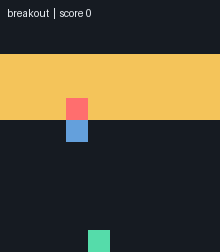
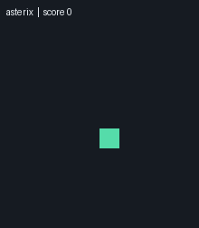
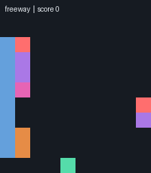
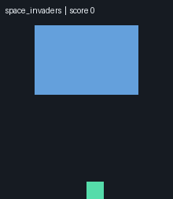
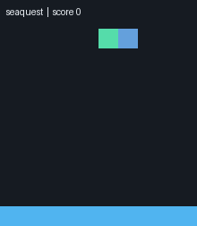

<div align="center">
  <h1>MinAtar JAX</h1>
  <h3>Five JAX games. One agent. One compiled training loop.</h3>
  <p>Atari-inspired MinAtar environments and a Flax actor–critic, compiled together end to end.</p>
  <p>
    
    
    
    <a href="LICENSE"></a>
  </p>
  <p><a href="#reproduce">Reproduce</a> · <a href="demo.py">Read the demo</a></p>
</div>

This project implements five Atari-inspired [MinAtar](https://github.com/kenjyoung/MinAtar)
games in **JAX**, alongside a small **Flax actor–critic**. The games use 10 × 10
grids, keeping both the environments and the learner small enough to read.

**The environment and learner share one compiled training loop.** Action sampling,
parallel game transitions, TD(0) targets, gradients, and Adam updates all run
together inside `nnx.jit`. Python handles setup and GIF rendering afterwards.

<table>
  <tr>
    <td valign="top" align="center" width="33%"><strong>Breakout</strong><br></td>
    <td valign="top" align="center" width="33%"><strong>Asterix</strong><br></td>
    <td valign="top" align="center" width="33%"><strong>Freeway</strong><br></td>
  </tr>
  <tr>
    <td valign="top" align="center"><strong>Space Invaders</strong><br></td>
    <td valign="top" align="center"><strong>Seaquest</strong><br></td>
    <td valign="top" align="center"><strong>Read the code</strong><br><br>Five environments.<br>One actor–critic.<br>One compiled loop.<br><br><a href="demo.py">Train and record →</a></td>
  </tr>
</table>

Every GIF uses seed **1000** with greedy actions, capped at 5,000 steps.
The episode is fixed in advance. One display frame represents four game steps,
played at 80 ms per frame (12.5 FPS) for easier viewing.

## Reproduce

Install [uv](https://docs.astral.sh/uv/getting-started/installation/), then:

```sh
sh scripts/reproduce.sh
```

This installs locked dependencies, trains the five fixed presets on CPU, and
writes one GIF per game to `results/`. Each model trains for 5,000 updates across
64 parallel games. The script prints total training time, including compilation,
and the recorded episode's score. It stores no weights or other artifacts.

For a different budget or output directory:

```sh
UPDATES=10000 sh scripts/reproduce.sh results-longer
```

For a quick pipeline check:

```sh
UPDATES=2 N_ENVS=2 MAX_STEPS=30 sh scripts/reproduce.sh /tmp/minatar-demo
```

Existing GIFs for the selected games are replaced. Fixed seeds and `uv.lock`
make the recipe repeatable on the same setup; exact results can differ across
JAX versions and hardware. These are small-budget examples from one training
seed, with no claim of a universal “solved” score.

## The learner

Separate convolutional policy and value networks use ReLU hidden layers, Adam,
and a one-step TD(0) target. The actor is trained with the detached advantage and
an entropy bonus. The actor uses a 16-channel convolution and 128-unit hidden
layer; the critic uses 32/16-channel convolutions and 256/128-unit hidden layers.
See [the implementation](minatar_jax/agent.py).

The game variants retain randomized Breakout starts and corner reflections,
randomized alien direction, and corrected Seaquest unloading. Seaquest uses the
original one-third submarine probability and oxygen-check ordering. Freeway lasts
exactly 2,500 steps. Scores are not interchangeable with full Atari benchmarks.

## Individual commands

```sh
uv run python demo.py --env breakout
```

Use `--help` for budgets, batch size, learning rates, episode limits, and output
paths. Game objects contain frozen settings only; state and random keys are
passed explicitly through `reset(key, n_envs=...)`, `step(state, actions)`, and
`observe(state)`.

```text
minatar_jax/agent.py    # Flax NNX networks and the TD(0) update
minatar_jax/factory.py  # explicit game factory
minatar_jax/environments/
demo.py                # train and record one episode
scripts/reproduce.sh    # five fixed presets
results/               # five GIFs
```

## Development

```sh
uv run ruff check --extend-select COM812 .
uv run ruff format --check .
uv run pyright
uv run python -W error::FutureWarning -m unittest discover -s tests -v
```

## License

[GPL-3.0-only](LICENSE). Original MinAtar: Kenny Young and Tian Tian. JAX port and
modifications: Enrico Bianchi (`enri8421`), 2022–2026. See [NOTICE](NOTICE).
